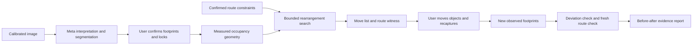

# Proposed architecture

## Stack and data flow

React/TypeScript/Vite frontend with SVG image/plan overlays; FastAPI/Pydantic backend; NumPy/OpenCV for planar calibration if needed; Shapely for geometry; SQLite/artifact storage and one bounded worker. A map tile service is unnecessary for a local measured board. [Vite](https://vite.dev/guide/), [FastAPI](https://fastapi.tiangolo.com/), [Shapely](https://shapely.readthedocs.io/en/stable/manual.html).

## Model contribution

Proposed `muse-spark-1.3`: interpret object labels and natural-language constraints into a validated schema. Proposed `sam-3.1`: generate image masks from prompted objects; convert to reviewed planar footprints. The [Meta media guide](https://dev.meta.ai/docs/media-segmentation) describes masks/boxes and suggests combining interpretation with segmentation. Performance on this scene and achievable dimensional error are **UNVERIFIED**. [Image understanding](https://dev.meta.ai/docs/image-understanding), [structured output](https://dev.meta.ai/docs/structured-output).

Calibration, metric geometry, connectivity and search are deterministic code. The model cannot declare a path accessible. A manual-layout baseline is mandatory: if confirming model footprints costs more than drawing rectangles, the AI benefit is weak. The initial prepared image/text probe checks extraction only; the real SAM adapter/mask decode remains a separately documented implementation step.

## Contracts and invariants

| Entity | Important fields/checks |
|---|---|
| Calibration | image size, measured corners, unit, homography, independent check length; reject ill-conditioned transform |
| ObjectFootprint | persistent object ID, mask reference, measured rectangle/polygon, uncertainty margin, locked flag, source observation |
| Constraints | entrance/destination, chosen clearance envelope, bounds, allowed placements, max moved objects; user-confirmed revision |
| Plan | changed IDs/poses, finite candidate-set description, move-count/displacement cost, route witness, input hash |
| Observation | recapture ID, calibration, newly measured object poses and unmatched objects |
| Verification | expected/actual pose deltas, collision/route result, uncertainty and unresolved mismatches |

Use one explicit coordinate frame and unit. Never confuse pixels with metres. Unknown objects/locks or stale constraints block planning. A new observation must be independently processed; it cannot use the desired plan to invent detected positions. Identity ambiguity goes to the user.

## Planner and verifier

For a chosen circular clearance envelope, expand obstacles by radius plus measurement margin, shrink permitted boundaries accordingly and test a centre path. A real wheelchair's orientation/turning behavior is beyond this envelope; name the assumption. Raster search is conservative at the selected resolution and should be cross-checked against continuous polygon intersection for exported route segments.

Enumerate validated non-overlapping placements on a declared finite grid, preserving locked objects. Compare zero moves, one move, then two; within that count minimize total displacement. A claim of optimality applies only to the enumerated set. If search times out, return 'search incomplete'; never call it impossible or globally minimal. If all allowed placements are exhausted without success, say no solution within this set.

Verification compares recaptured geometry to expected poses within a declared tolerance, then recomputes connectivity from actual geometry. It must identify both a correct move and a deliberately wrong move. Small measured clearance near the tolerance boundary triggers remeasurement.

## Runtime and testing

Reuse the [base run/service pattern](../../drawn-to-scale/docs/02-ARCHITECTURE.md): server-only credentials, bounded worker, persisted stages, interrupted-run retry, request access tokens, input limits and versioned model/prompt/capture evidence. States: measuring → needs_confirmation → planning → awaiting_recapture → verifying → ready/needs_remeasurement, with failure/cancel paths.

Unit tests cover units, locked objects, overlap, path boundaries, no-solution limits and optimization cost. Integration covers model failure, stale images and unknown identity. Model evaluation measures footprint error against a ruler/reference drawing and constraint extraction against a hand-written expected schema. Physical test evaluation reports route agreement and after-state detection over unseen layouts. Mock extraction never counts as model evidence.
